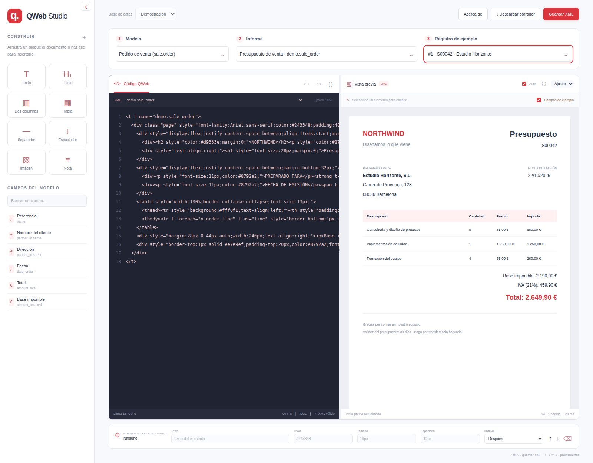

# Odoo QWeb Editor

Editor visual de informes y plantillas QWeb de Odoo, desarrollado por **[kikedev64](https://github.com/kikedev64/kikedev64)**.

Repositorio: **[kikedev64/Odoo-QWeb-Editor](https://github.com/kikedev64/Odoo-QWeb-Editor)** · Aplicación: **QWeb Studio** · Comando: `odoo-report-editor`.

Abre una terminal en tu proyecto Odoo, ejecuta `odoo-report-editor` y selecciona un modelo, un informe y un registro de ejemplo. Edita el XML y consulta el resultado en una vista A4 que se actualiza mientras trabajas.



## Índice

- [Funcionalidades](#funcionalidades)
- [Requisitos](#requisitos)
- [Inicio rápido desde GitHub](#inicio-rápido-desde-github)
- [Instalar el `.deb`](#instalar-el-deb)
- [Generar el instalador](#generar-el-instalador)
- [Uso](#uso)
- [Exportación](#exportación)
- [Campos de ejemplo y límites](#campos-de-ejemplo-y-límites)
- [Conexión y aislamiento](#conexión-y-aislamiento)
- [Arquitectura y API local](#arquitectura-y-api-local)
- [Solución de problemas](#solución-de-problemas)
- [Desarrollo](#desarrollo)
- [Autoría y licencia](#autoría-y-licencia)

## Funcionalidades

- Detección del servicio Odoo y sus bases de datos a partir de Docker Compose.
- Selección de modelo → informe → registro, con búsqueda por ID, nombre, referencia o cliente.
- Editor XML junto al PDF generado por Odoo con el borrador actual y una vista HTML para editar visualmente.
- Fuentes, CSS e imágenes locales incorporados desde la base de datos seleccionada, incluidos recursos privados y bundles generados durante el renderizado.
- Selección sincronizada entre el elemento visual y su posición en el código.
- Hojas A4 numeradas, márgenes del informe y continuación del contenido en varias páginas.
- Bloques de texto, títulos, tablas, columnas, imágenes y campos que puedes insertar o arrastrar.
- Inspector de texto, expresiones, color, tamaño y espaciado; deshacer y rehacer.
- Panel de bloques y campos plegable, zoom y ancho de paneles ajustable.
- Campos de ejemplo para previsualizar plantillas que utilizan campos ausentes.
- Exportación de XML sin sobrescribir los módulos ni guardar el borrador en Odoo.

## Requisitos

Para instalar el paquete Debian:

- Ubuntu 24.04 o un sistema Debian/Ubuntu con Python 3.11+, FastAPI 0.101+, Uvicorn 0.27+ y lxml 5+. APT resuelve estas dependencias.
- Un navegador web para abrir la interfaz.

Para trabajar con un proyecto real también necesitas Docker, el plugin **Docker Compose v2**, permisos para usar Docker y el servicio Odoo con su PostgreSQL en ejecución. El instalador no instala ni arranca Odoo o Docker.

La integración se ha probado con Odoo **14, 16, 18 y 19**. La compatibilidad de cada informe también depende de sus módulos y datos. El modo demo funciona sin Docker.

## Inicio rápido desde GitHub

Con Git, Python 3.11 o posterior y soporte para `venv` instalados:

```bash
git clone https://github.com/kikedev64/Odoo-QWeb-Editor.git
cd Odoo-QWeb-Editor
python3 -m venv .venv
source .venv/bin/activate
python -m pip install -e .
odoo-report-editor --demo
```

En Debian/Ubuntu, si faltan las herramientas de Python, instala `python3-venv` y `python3-pip` con APT. La instalación desde fuentes necesita acceso al índice de paquetes para resolver las dependencias.

La demo abre `http://127.0.0.1:8765` y permite probar el flujo con presupuestos ficticios. Para conectar un proyecto real, detén la demo con **Ctrl+C** y ejecuta, desde el mismo entorno virtual:

```bash
odoo-report-editor /ruta/a/mi-proyecto-odoo --service odoo -d mi_base
```

Sustituye la ruta, el servicio y la base de datos por los de tu proyecto. Puedes omitir `--service` cuando la detección sea inequívoca y `-d` para elegir la base en la interfaz. El editor es una aplicación local independiente: su instalación no requiere añadir un módulo a Odoo.

## Instalar el `.deb`

Genera primero el paquete con `./build_deb.sh`, como se explica en la siguiente sección. Desde la raíz de esta copia del repositorio:

```bash
sudo apt install ./dist/odoo-report-editor_0.1.0_all.deb
```

El paquete instala `/usr/bin/odoo-report-editor` y la aplicación en `/usr/share/odoo-report-editor/`. Usa las bibliotecas Python gestionadas por APT; no descarga paquetes con pip durante la instalación ni requiere activar un entorno virtual.

Después puedes ejecutarlo desde cualquier terminal:

```bash
cd /ruta/a/mi-proyecto-odoo
odoo-report-editor
```

Para desinstalarlo:

```bash
sudo apt remove odoo-report-editor
```

Los XML exportados dentro de tus proyectos se conservan.

## Generar el instalador

Necesitas Bash, Python 3.11+, `dpkg-deb` y las utilidades habituales de GNU/Linux. En Ubuntu:

```bash
sudo apt install python3 dpkg gzip coreutils findutils
./build_deb.sh
```

Se genera `dist/odoo-report-editor_0.1.0_all.deb`, junto a su suma SHA-256 en un fichero `.sha256`. La versión se toma de `pyproject.toml`. La construcción no necesita permisos de administrador, acceso a Internet, un entorno virtual ni un proyecto Odoo.

Puedes elegir otra carpeta de salida:

```bash
./build_deb.sh /tmp/instaladores
```

Para reproducir un paquete con las mismas fechas de construcción, fija `SOURCE_DATE_EPOCH`. Si no lo defines, se usa la fecha del último commit o, en una carpeta sin historial, la fecha actual.

```bash
SOURCE_DATE_EPOCH=1792627200 ./build_deb.sh
```

El paquete incluye únicamente la aplicación, sus recursos web y documentación. No incluye el entorno virtual, pruebas, resultados de auditorías, bases de datos ni exportaciones.

## Uso

También puedes indicar el proyecto sin cambiar de directorio:

```bash
odoo-report-editor /ruta/a/mi-proyecto-odoo
```

Se abre `http://127.0.0.1:8765` en el navegador.

1. Si hay varias bases de datos, selecciona la que quieres usar.
2. Elige el **modelo**, por su nombre descriptivo o técnico, como `sale.order`.
3. Selecciona el **informe**. Se muestra `nombre de ir.actions.report - report_name`.
4. Busca y selecciona un **registro de ejemplo**. `#123` busca directamente el ID 123. El editor no elige un registro por ti.
5. La opción **PDF de Odoo**, seleccionada inicialmente en proyectos reales, muestra el borrador con el motor PDF, las tipografías y el formato de papel del informe. Edita el XML y la vista se actualiza tras una breve pausa. El visor PDF tiene sus propios controles de zoom. Cambia a **Edición visual** para utilizar los bloques, seleccionar elementos y usar el inspector; su paginación HTML es aproximada. Los informes HTML y la demo utilizan esta segunda opción.
6. Pulsa **Guardar XML** para exportar la plantilla. **Descargar borrador** descarga únicamente su arquitectura XML.

La flecha del panel de bloques y campos permite plegarlo; el navegador recuerda esa preferencia. Los elementos repetidos por un bucle comparten la misma etiqueta del template.

| Opción | Uso |
| --- | --- |
| `--demo` | Probar la aplicación con datos ficticios, sin Odoo. |
| `--service NOMBRE` | Seleccionar el servicio Odoo del Compose. |
| `--database NOMBRE`, `-d NOMBRE` | Elegir la base de datos. |
| `--compose-file FICHERO`, `-f FICHERO` | Usar un Compose alternativo. |
| `--python RUTA` | Elegir el Python **dentro del contenedor**. |
| `--port NUMERO` | Cambiar el puerto del editor; por defecto, 8765. |
| `--no-browser` | Arrancar sin abrir automáticamente el navegador. |
| `--help` | Mostrar las opciones disponibles. |

```bash
odoo-report-editor --demo
odoo-report-editor /ruta/proyecto -d mi_bd --service odoo
odoo-report-editor /ruta/proyecto -f desarrollo.yml --port 8877 --no-browser
```

Atajos: **Ctrl/Cmd S** guarda XML; **Ctrl/Cmd Enter** actualiza la vista previa.

## Exportación

Cada guardado crea un fichero nuevo:

```text
mi-proyecto-odoo/
└── report_editor_exports/
    └── sale.report_saleorder_document_FECHA_IDENTIFICADOR.xml
```

Contiene un registro `ir.ui.view` dentro de `<odoo>`, con su identificador externo y arquitectura QWeb. Puedes incorporarlo a los datos de un módulo y declararlo en su `__manifest__.py`.

Conserva el identificador externo para actualizar una vista existente. Para crear otra, asigna un identificador distinto y conéctala al informe correspondiente. El editor no aplica ese XML a la base de datos ni modifica los ficheros originales del proyecto.

## Campos de ejemplo y límites

**Campos de ejemplo** está desactivado inicialmente en proyectos reales para comprobar los datos y las condiciones reales. La demo lo activa inicialmente. Si lo activas, primero se intenta renderizar con datos reales; si falla un campo ausente, se sustituye en una copia temporal por una referencia como `[sale.order.custom_reference]`. El aviso enumera los campos sustituidos. Se admiten relaciones, alias de bucles y ciertos formateadores de campos ausentes, con un máximo de 32 sustituciones por petición.

La visualización es aproximada: las condiciones pueden activarse para mostrar una sección; los cálculos usan cero y las colecciones ausentes una fila de ejemplo. Desactiva esta opción para comprobar el renderizado estricto. Los placeholders no se guardan en el XML exportado ni crean campos en Odoo.

Ten en cuenta:

- **PDF de Odoo** utiliza el motor PDF y el formato de papel de la acción, con sus márgenes, orientación, cabeceras y pies. Requiere que el generador PDF de Odoo esté instalado. No reutiliza adjuntos de informes anteriores. Los borradores y sus recursos temporales se procesan sin confirmar la transacción.
- **Edición visual** utiliza HTML paginado en **A4 vertical de 210 × 297 mm**. Conserva los márgenes del formato de papel, repite cabeceras y pies externos y evita dividir filas de tablas cuando caben en una hoja. Puede diferir del PDF, especialmente con tablas complejas, posiciones fijas o contenido indivisible mayor que una página. Utiliza la opción PDF para revisar el resultado final.
- Se listan las plantillas base alcanzables mediante `t-call` estáticos. La edición visual de extensiones XPath y las llamadas calculadas dinámicamente tienen limitaciones.
- Los elementos añadidos por vistas heredadas no tienen necesariamente un marcador propio del editor.
- Un informe puede necesitar datos de un asistente, un registro concreto o módulos adicionales. Las etiquetas estándar de producto preparan su asistente en memoria; no se guarda en la base de datos.
- No se fabrican métodos de Python, variables de contexto ni columnas SQL ausentes. Los errores de código, esquema y módulos siguen requiriendo corregir el entorno o la plantilla. El editor conserva la última vista válida y muestra el detalle técnico.
- Los recursos estáticos de módulos, adjuntos, imágenes de campos binarios y códigos de barras se leen dentro del contenedor y se incorporan al documento, junto con las fuentes referenciadas por CSS. Los recursos externos conservan sus URLs y necesitan ser accesibles. Se muestran avisos para los recursos locales que no existen o no se pueden incorporar.
- La imagen de muestra de la paleta debe sustituirse por una URL válida antes de utilizar el informe fuera del editor.
- Los borradores sin exportar se pierden al cerrar. Las consultas SQL tienen un límite de 30 segundos por sentencia.

## Conexión y aislamiento

El editor resuelve la configuración con `docker compose config --format json`, respetando `.env` y los overrides habituales. Reconoce opciones de conexión del comando, la configuración de Odoo y variables habituales de las imágenes oficiales y Doodba.

Se prefiere el contenedor habitual del servicio. También se admite un único contenedor creado con `docker compose run` cuando el servicio normal no está arrancado. No se elige entre varios contenedores ambiguos ni se arrancan contenedores automáticamente.

Se consultan las bases configuradas por Odoo y se filtran las que contienen su esquema. `POSTGRES_DB` no se toma automáticamente como la base de trabajo del editor.

El ORM se ejecuta como superusuario en un proceso privado del contenedor. Los borradores se inyectan únicamente en su caché y cada consulta termina en rollback. No se instalan ni actualizan módulos. El rollback no puede deshacer llamadas externas de módulos personalizados, y la inicialización del registro conserva el comportamiento normal de Odoo.

La interfaz solo escucha en `127.0.0.1`; el iframe de previsualización desactiva scripts y formularios.

## Arquitectura y API local

La interfaz está escrita en HTML, CSS y JavaScript y se sirve con FastAPI y Uvicorn. No requiere Node.js ni una compilación del frontend. `project.py` descubre Docker Compose y mantiene un proceso Python privado dentro del contenedor Odoo; `docker_worker.py` realiza las consultas y el renderizado con el ORM y QWeb del propio proyecto. `qweb_support.py` gestiona la resolución de plantillas y los campos de ejemplo, y `preview_resources.py` incorpora los recursos del informe.

El flujo de una vista previa es: navegador → API local → proceso dentro de Odoo → renderizado HTML o PDF → navegador. El código de paginación y selección visual está en `report_editor/static/`.

Con el servidor arrancado, la documentación interactiva está en [`/docs`](http://127.0.0.1:8765/docs) y el esquema OpenAPI en [`/openapi.json`](http://127.0.0.1:8765/openapi.json).

| Método y ruta | Función |
| --- | --- |
| `GET /api/status` | Modo, proyecto, servicio y bases disponibles. |
| `POST /api/database` | Seleccionar la base de datos de la sesión. |
| `GET /api/reports` | Listar informes y sus modelos. |
| `GET /api/templates` | Buscar plantillas y filtrar por informe. |
| `GET /api/templates/{template_id}` | Obtener el XML y la revisión de una plantilla. |
| `GET /api/records` | Buscar registros de un modelo. |
| `GET /api/fields` | Consultar campos para insertar en la plantilla. |
| `POST /api/preview` | Renderizar el borrador en HTML o PDF. |
| `GET /api/preview.pdf` | Obtener el PDF de la sesión con su token temporal. |
| `POST /api/save` | Exportar la plantilla a un nuevo archivo XML. |

La API utiliza la cookie `editor_session`. Las peticiones que modifican el estado requieren `X-Editor-Request: 1` y, si incluyen `Origin`, debe coincidir con el origen del editor. Para automatizar peticiones, conserva la cookie entre llamadas y consulta los cuerpos JSON en OpenAPI; la interfaz ya gestiona estos requisitos.

## Solución de problemas

| Síntoma | Comprobación o solución |
| --- | --- |
| No se encuentra Docker Compose | Ejecuta el editor con la ruta del proyecto que contiene el Compose, o indica el fichero mediante `-f`. |
| No se puede elegir el servicio | Especifica `--service NOMBRE` y comprueba `docker compose config` dentro del proyecto. |
| No se encuentra un contenedor arrancado | Comprueba `docker compose ps` y arranca el entorno Odoo por el procedimiento habitual de tu proyecto. |
| Docker rechaza el acceso | Comprueba que tu usuario puede ejecutar Docker y que el daemon está disponible. |
| Python no puede importar Odoo | Usa `--python` con el intérprete del contenedor que tenga instalado Odoo. |
| No aparece la base de datos | Revisa la conexión PostgreSQL de Odoo y selecciona una base con su esquema inicializado. |
| No aparecen registros | Confirma el modelo, la base seleccionada y que existan datos; busca un registro concreto con `#ID`. |
| Falla la vista PDF | Comprueba el generador PDF del contenedor y los requisitos de la acción; consulta el detalle técnico del error. |
| Faltan imágenes o fuentes | Revisa los avisos de recursos y la existencia de archivos, adjuntos y URLs externas. |
| Un campo personalizado impide renderizar | Activa **Campos de ejemplo** para explorar el diseño y corrige el campo o el módulo para validar el informe real. |
| El puerto está ocupado | Arranca con otro puerto, por ejemplo `--port 8877`. |
| No se abre el navegador | Abre manualmente la URL que imprime la terminal; `--no-browser` desactiva su apertura automática. |

Para comunicar un error, utiliza los [issues del repositorio](https://github.com/kikedev64/Odoo-QWeb-Editor/issues) e incluye pasos para reproducirlo, versión de Python y Odoo, modo utilizado y el detalle técnico pertinente. Elimina credenciales y datos privados de los ejemplos.

## Desarrollo

Instala una copia editable en un entorno virtual:

```bash
python3 -m venv .venv
source .venv/bin/activate
pip install -e '.[dev,browser]'
playwright install chromium
pytest -q
```

Para comprobar la interfaz, arranca la demo en una terminal:

```bash
odoo-report-editor --demo --port 8880 --no-browser
```

En otra terminal con el mismo entorno virtual:

```bash
python tests/browser_smoke.py --url http://127.0.0.1:8880
python tests/browser_layout.py --url http://127.0.0.1:8880
```

Después de instalar el `.deb`, también puedes verificar el comando, la API y la exportación desde una carpeta temporal:

```bash
python3 tests/installed_smoke.py
```

Para revisar proyectos reales que ya estén arrancados:

```bash
python tests/integration_projects.py /ruta/proyecto-1 /ruta/proyecto-2
python tests/browser_projects.py --url http://127.0.0.1:8765
```

La auditoría crea `artifacts/integration-results.json`. Recorre las acciones QWeb y prueba su primera plantilla editable con el registro más reciente; distingue documentos renderizados, modelos sin registros, informes sin plantilla editable y errores. No busca automáticamente un registro que satisfaga las condiciones de negocio de cada informe. La exportación se comprueba en una carpeta temporal y las pruebas de navegador no guardan cambios en Odoo.

```text
report_editor/          Aplicación Python y proceso de integración con Odoo
report_editor/static/   Interfaz, selección XML y paginación A4
tests/                  Pruebas automáticas y de navegador
packaging/              Lanzador y metadatos del paquete Debian
docs/images/            Captura de la interfaz
build_deb.sh            Generador del instalador
pyproject.toml          Metadatos y dependencias Python
```

Los comentarios del código se limitan a docstrings de Python y JSDoc en inglés. Los shebangs de los ejecutables son directivas de ejecución.

## Autoría y licencia

Desarrollado por **[kikedev64](https://github.com/kikedev64/kikedev64)**. La misma atribución aparece en «Acerca de» dentro de la aplicación.

Este proyecto se distribuye bajo los términos de la licencia MIT. Consulta el fichero `LICENSE` para ver el texto completo.
